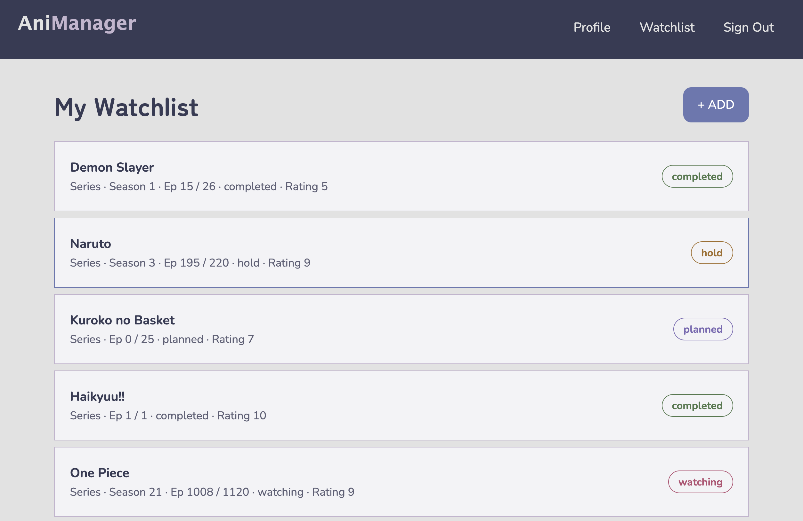

# 🍿 Anime Watchlist

Keep track of what you're watching, what you've finished, and what's next.

**Live Demo:** [[Add Render link here](https://anime-watchlist-lzj5.onrender.com/login)]

---

## 📖 About

Anime Watchlist helps users organize their shows. Add an anime, give it a status (Watching, Completed, or Plan to Watch), and update it as you go. Finished a series? Mark it completed, or remove it from the list entirely.

[Add anything special here: ratings, episode tracking, an anime API, etc.]

---

## 🛠️ Built With

Node.js · Express · MongoDB · Mongoose · EJS [· any API you used]

---

## 📸 Preview



---

## 💡 What I Learned

- Full CRUD with Express and Mongoose
- Updating a single field, like a show's status
- Grouping or filtering a list by status
- Building a project around something I actually use

---

## 🚀 Run It Locally

```bash
git clone https://github.com/smayanja3/[repo-name].git
cd [repo-name]
npm install
```

Create a `.env` file:

```
MONGODB_URI=your-mongodb-connection-string
PORT=5030
```

Then run `npm run dev` and open `http://localhost:5030`.